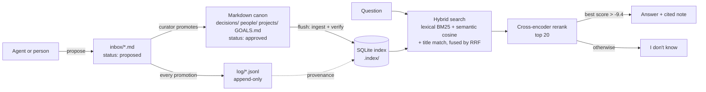

# BotCanon

**Memory for your AI bots (Grok Bots first).** Instead of rereading long chat histories, your bots look up short, quoted facts from a set of notes you control, and say "I don't know" when the notes don't say.

**How to read this page:** it starts plain and gets more technical as it goes. Stop whenever it stops being useful; the setup steps don't need anything past "Getting started".

Your vault starts empty: a skeleton of folders and a `GOALS.md` stub. Nothing to delete first.

## In one minute

- **The problem.** Bots that run for weeks either forget, or carry their whole chat history around. Rereading history uses up your plan's usage, fills the bot's working memory (its context window) so less room is left for the actual task, and is a poor way to find one fact buried in old messages.
- **The fix.** Keep the facts that matter in a small set of notes. When a bot needs one, it asks a question and gets back a few lines with the file and line they came from, not the whole history.
- **Trust.** Newer decisions outrank older ones, replaced facts are labelled as replaced, and a bot can only suggest new facts. You (or one bot you choose) decide what goes in.
- **Who it's for.** People running one or more Grok Bots or other AI agents that need a shared, checkable memory.

## What this is, and what it isn't

- **It is your bots' memory:** the facts, decisions and rules they need to work, kept outside any one chat.
- **It is not a replacement for your own notes app or personal second brain.** Keep using whatever you like for your own thinking.
- **If you don't have one you like,** the same engine can run a separate vault for other material (a novel, project docs) without mixing it with your bots' memory. See [docs/EXTENDING.md](docs/EXTENDING.md).

## Why not just keep the chat history?

| | Rereading chat history | Looking it up here |
|---|---|---|
| What the bot reads | Everything said so far, relevant or not | A few quoted lines, ranked |
| Usage | Grows with every message | Stays about the same size per question |
| Room left for the task | Shrinks as history grows | Mostly untouched |
| Finding an old fact | Depends on the bot noticing it in a long scroll | Search by words and by meaning, then a second check |
| Outdated facts | Old and new statements sit side by side | Replaced facts are marked and ranked down |
| Proof | "I remember" | `file:line "quote"`, checked against the file |

**On usage savings: expected, not measured.** We have not measured token or usage savings on real bots. What we can measure: a lookup on the small test fixture returns about 430 to 550 characters, roughly 110 to 140 tokens (assuming about 4 characters per token). To estimate your own saving, count the characters in a chat history your bot would otherwise reread, divide by 4, and compare with that lookup size. Savings depend on your bots looking things up here instead of relying on long chats. The agent rules below make that the default; the chat app still decides how much history it loads.

## What you get


- **One memory for all your assistants.** Notes are plain Markdown in git, so every agent, and you, read the same record. Nothing lives only in one chat.
- **Answers you can check.** `answer` returns `file:line "quote"` and confirms the line is really in the file. In the author's vault, with agents following the [Agent rules](#agent-rules), made-up answers on a held-out set of 22 off-topic questions went from 22 to 0, while 1 of 10 real questions got a wrong "I don't know".
- **Better search than plain embeddings, measured.** On the public test set (a small fictional fixture in `tests/fixtures/`, used only by CI and the bench): top-result hit rate 0.79 vs 0.75 for plain embeddings (one more right answer out of 28), and no-answer questions handled correctly 3 of 3 vs 0 of 3 (plain embeddings always return something, so they can't score there). It's a small smoke-test set, not proof of quality; check your own vault with `verify`.
- **You stay in charge.** Agents can only propose to `inbox/`. You, or one curator agent, decide what becomes a fact, and the log keeps who said what, and when.
- **It tells you when it breaks.** `verify` runs your test questions on every change and refuses to save if search got worse or the index is stale.
- **Private and free to run.** Everything runs locally: SQLite and a small model, with no server and no API key.

Not promised: it does not judge whether a fact is true, does not summarize across notes, does not shrink a chat history by itself, and can still miss questions worded very differently from the note (see [Known limits](#known-limits)).

## What it costs


| | |
|---|---|
| **Time** | Estimate: about 60 minutes for a first setup if you've never used GitHub, about 10 if you have. Then a few minutes per batch of notes to review the inbox. |
| **Accounts** | A free [GitHub](https://github.com/signup) account. Keep your copy **private**: it will hold facts about you. |
| **Software** | [GitHub Desktop](https://desktop.github.com/) (or git), [Python 3.10+](https://www.python.org/downloads/), and [gitleaks](https://github.com/gitleaks/gitleaks#installing), which blocks accidental secrets. All free. |
| **Skills** | Copying and pasting commands into a terminal, and editing text files. No programming. |
| **Computer** | Any recent Mac, Windows or Linux machine. About 200 MB of disk, including a ~80 MB model downloaded on first run. |
| **Ongoing** | Write notes and run `flush` after edits. Optional: a second agent with its own hidden test questions ([docs/EVAL-AGENT.md](docs/EVAL-AGENT.md)). |

## Getting started (no coding background)

Pick two bots: a Curator that keeps the memory ([docs/CURATOR-AGENT.md](docs/CURATOR-AGENT.md)), and an Evaluator that tests it ([docs/EVAL-AGENT.md](docs/EVAL-AGENT.md)). Both pages have a description you can paste.

Setup times are estimates. The Windows steps are untested; reports welcome.

1. **Make a GitHub account.** Go to https://github.com/signup and follow the steps. The free plan is enough.
2. **Install GitHub Desktop** from https://desktop.github.com/ and sign in with that account.
3. **Get your own copy of this repo.** Open https://github.com/rsj2h4sr86-creator/botcanon, click **Use this template**, then **Create a new repository**. Name it `my-brain` and choose **Private**.
4. **Clone it to your computer.** In GitHub Desktop, choose **File → Clone repository**, pick `my-brain`, choose a folder, then click **Clone**.
5. **Install Python** 3.10 or newer from https://www.python.org/downloads/. On Windows, tick **Add python.exe to PATH** in the installer.
6. **Install gitleaks.** Mac: `brew install gitleaks`. Windows or Linux: download the release for your system from https://github.com/gitleaks/gitleaks/releases and put it on your PATH.
7. **Open a terminal in the folder.** In GitHub Desktop, choose **Repository → Open in Terminal** (Mac) or **Open in Command Prompt** (Windows).
8. **Run these lines one at a time:**
   ```sh
   python3 -m venv .venv
   . .venv/bin/activate        # Windows (untested): .venv\Scripts\activate
   pip install -r requirements.txt
   tools/install-hooks.sh      # Windows (untested): run in Git Bash
   python3 tools/brain.py ingest
   python3 tools/brain.py verify
   ```
   On a fresh copy the last lines say `evals: none yet` and `verify: YELLOW`. That is expected: there are no notes or tests yet. The first run downloads a small search model (not data), so it takes a minute.
9. **Add your notes.** Write a few short notes in `decisions/`, `people/` and `projects/` (one fact per line; see [How it works](#how-it-works)), and replace the stub in `GOALS.md`.
10. **Build your own tests:** `python3 tools/brain.py evals init`. It reads your current notes (skipping replaced ones and `CURRENT.md`) and writes `evals/proposed_tests.yaml`, which is never committed. Each test names the note it should find and the line (`source: path:line`). Where a fact has a clear field (Role, Why, Last contact), you get a ready question; otherwise the query says `REWRITE:` and you write the question you'd really ask, without copying the answer's words. Delete weak tests, set `reviewed: true` on each one you keep, then run `python3 tools/brain.py evals accept` (it refuses `REWRITE:` placeholders and unreviewed tests; `--all-reviewed` confirms you checked them all). Never change an expected note just to make a test pass. Add `--owner "<your name>"` to `init` to also test questions about you that the notes can't answer (the weak spot under Known limits). Add `--quotes` to `init` only if you want the answer line copied into the test file.
11. **Save it:** `python3 tools/brain.py flush -m "my first notes" --push`. It re-indexes, runs your tests, commits only if nothing is RED, and with `--push` sends it to GitHub (it refuses if GitHub says the repo is public). verify should now say `GREEN`, and you can see the change on github.com.
12. **Ask it something:** `python3 tools/brain.py answer "<a question your notes answer>"`. It quotes the line, or says "I don't know".

Stuck? Paste the error into any AI assistant along with this README.

## How it works

Plain version: your notes are the record; the index is just a fast way to search them and can be rebuilt any time. A question is matched two ways, by exact words and by meaning, and a second model re-checks the best matches. Decisions count a little more than general notes, and replaced decisions sink. An answer must quote a line from a note that actually states the fact; otherwise you get "I don't know". Every change re-runs the test questions before it is saved.

The pieces, for the curious:



- **Notes** are plain Markdown files in git: the record. The **index** is a SQLite file built from them; delete it and it rebuilds.
- **Search** runs two ways, exact words (BM25) and meaning (local embeddings), merges them, then a small second model re-scores the top 20.
- **Trust ranking:** decisions and goals edge out other notes; replaced decisions and unreviewed proposals sink to 0.1.
- **Answers** must quote a line that is verified to be in the file and states the asked fact (cite-and-verify); otherwise "I don't know".

Full details (storage, status field, ranking weights, freshness, cite-and-verify, design rationale): [docs/HOW-IT-WORKS.md](docs/HOW-IT-WORKS.md). The design essay is [docs/WHY.md](docs/WHY.md).

## Known limits

- **The "I don't know" gate is NOT reliable for questions about the owner's personal attributes. Callers must check the citation themselves.** In the author's real vault at the -9.4 cutoff, a confident-looking but wrong answer came back for 5 of 6 calibration questions like "what is Lance's blood type" or "who is Lance's dentist", and for **22 of 22** questions in a separate held-out set (20 "Lance + attribute" questions such as favorite color, doctor or home address, plus 2 questions about a bot the vault knows nothing about). The owner's name appears in many notes, so the reranker scores these as relevant. On general off-topic questions with no owner name, 1 of 21 got a made-up answer ("what time does Costco close"). If the cited note doesn't say it, the brain doesn't know. Cite-and-verify plus rule 2 (Agent rules) brings this to 0 of 22 in the same test; the score gate alone does not.
- It does not judge truth. It returns what the curator promoted.
- It does not merge, summarize or reason across many notes. It returns ranked passages, and the calling agent writes the answer.
- It is not multi-user or concurrent. Run one curator per store.
- It indexes `.md` only. Paraphrases whose wording is far from the note can still miss the top 3; see the bench table.
- Scores are calibrated on small stores. Re-check the -9.4 cutoff on yours with `bench.py`.
- The reranker adds about 0.5 s per query on CPU, so `verify` (and `flush`, which runs it) takes roughly 0.5 s per test: about 40 s for 80 tests. Keep the tests file to the questions that matter, or run `flush` once per batch rather than per note.

## Agent rules

Put these in every agent's boot instructions. The numbers come from the author's real vault, measured on a held-out set written before any tuning: 22 off-topic "owner + attribute" questions (such as the owner's favorite color or doctor) and 10 answerable paraphrases.

1. **Check the second brain before stating facts about the owner. Chat memory is a hint, not proof.** Memory feels confident whether or not it is right. So does search: with the score cutoff alone, 22 of 22 off-topic owner questions got a confident-looking wrong answer. Only a cited note counts.
2. **Answer only from a quoted line in the cited note that states the fact. Otherwise say "I don't know".** This is the rule that fixed the gate. The quote check in code alone cut made-up answers from 22/22 to 1/22, but it said "I don't know" to 5 of 10 real questions, because notes word things differently ("son" vs the son's name). With an agent judging the verified candidate lines under this rule, the result was **0 of 22 made up and 1 of 10 false "I don't know"**. A related line ("Durable identity (accounts, emails)") is not an answer to "what is the owner's bank account number".
3. **File lasting facts and decisions to `inbox/` with source and date. Never write canon directly (the curator is the exception).** `propose` writes `status: proposed`, which ranks at 0.1, and `verify` fails if a proposed note sits in canon. One reviewer keeps canon consistent, the log records who said what, and unreviewed text can't outrank a decision.
4. **Before ending substantial work, update your HANDOFF note (`templates/HANDOFF.md`) with current work, next step and open items, each with its source file.** Session state isn't in the brain by design. In the pilot, "what is the bot working on right now" and "what is its next step" correctly got "I don't know" from the brain. The HANDOFF is the only place that state lives. Sources make it checkable at the next boot, and keeping it out of the index stops stale working notes from being quoted as facts.

## Quickstart (terminal)

```sh
git clone https://github.com/rsj2h4sr86-creator/botcanon.git my-brain && cd my-brain
python3 -m venv .venv && . .venv/bin/activate
pip install -r requirements.txt          # fastembed downloads BAAI/bge-small-en-v1.5 on first use
tools/install-hooks.sh                   # needs gitleaks on PATH (see Secret scanning)
python3 tools/brain.py ingest
python3 tools/brain.py verify            # empty vault: YELLOW, "no evals yet; run evals init"
python3 tools/brain.py evals init        # after adding notes: propose tests from them
python3 tools/brain.py evals accept      # after reviewing evals/proposed_tests.yaml and marking tests reviewed: true
```

More commands:

```sh
python3 tools/brain.py search "<question>"                                 # ranked hits with file:line
python3 tools/brain.py answer "<question>"                                 # cited answer, or "I don't know" (exit 2)
python3 tools/brain.py why "<topic>"                                       # provenance: From, Source, Date, log claims
python3 tools/brain.py compile <entity>                                    # current facts, with OUTRANKED/SUPERSEDED history
python3 tools/brain.py propose "<fact>" --from-agent <bot> --source "<where>"
python3 tools/bench.py                                                     # regenerate the results table below (scores the test fixture)
./demo.sh                                                                  # a narrated tour on a throwaway copy of the test fixture, about 1 minute
```

After you edit notes, run `python3 tools/brain.py flush -m "what changed"`. It re-ingests only changed files, runs verify, refuses to commit on RED, then commits. It pushes only with `--push`, and refuses to push if GitHub says the repo is public (`--allow-public` overrides). If nothing changed, it does nothing.

## Results

Generated by `python3 tools/bench.py` on the test fixture in `tests/fixtures/vault/`. Don't edit by hand. CI regenerates it on every run and fails if it differs.

<!-- BENCH:START -->
Public set: 28 answerable + 3 no-answer questions (`tests/fixtures/vault/evals/public_set.yaml`, a fictional test fixture).

| System | Hit@1 | Hit@5 | MRR | No-answer correct |
|---|---:|---:|---:|---:|
| plain embeddings (baseline) | 0.75 | 0.96 | 0.85 | 0.00 |
| lexical FTS5 only | 0.68 | 0.79 | 0.73 | 0.67 |
| hybrid, no rerank | 0.75 | 0.96 | 0.84 | 0.67 |
| hybrid, no rerank + answer gate | 0.75 | 0.93 | 0.83 | 0.67 |
| hybrid + rerank (this repo) | 0.79 | 0.96 | 0.86 | 0.67 |
| hybrid + rerank + answer gate | 0.79 | 0.89 | 0.84 | 1.00 |
<!-- BENCH:END -->

Notes on these numbers: [docs/HOW-IT-WORKS.md](docs/HOW-IT-WORKS.md#retrieval-results-notes-on-the-public-set).

## Layout

| Path | What lives there |
|---|---|
| `decisions/` | One file per decision: `- Status: approved`, `- Date:`, `- Owner:`, `- Decision:`, optional `- Prior:`, `- Revisit:`. A replaced decision gets `- Status: superseded` |
| `people/`, `projects/` | One note per person or project, each with `- Status: approved` under its title |
| `GOALS.md` | Goals and house rules |
| `CURRENT.md` | Derived dashboard; it ranks below its sources |
| `log/*.jsonl` | Append-only claims (`id`, `ts`, `entity`, `text`, `successor`). Read by compile, never searched |
| `inbox/` | Proposals waiting for the curator. Never searched |
| `skills/` | Agent instructions for promoting and retrieving |
| `tools/` | `brain.py`, goldens, hooks |
| `docs/` | How it works, the design essay, the curator and eval agents, extending to other stores |

## MCP server

`tools/mcp_server.py` exposes the vault to any MCP client over stdio. Tools: `search`, `answer`, `compile`, `why`, and `propose`. `propose` writes one file to `inbox/` and nothing else, and no tool writes canon. `python3 tools/test_mcp.py` runs it end to end against a temp copy and checks that canon is unchanged.

```json
{"mcpServers": {"second-brain": {"command": "python3", "args": ["/path/to/repo/tools/mcp_server.py"],
                                  "env": {"BRAIN_VAULT": "/path/to/repo"}}}}
```

## Going further

- [docs/CURATOR-AGENT.md](docs/CURATOR-AGENT.md): a ready-to-paste description for the one bot that writes canon.
- [docs/EVAL-AGENT.md](docs/EVAL-AGENT.md): a second agent keeps hidden test questions, so the curator can't grade itself. Recommended once you rely on the brain.
- [docs/EXTENDING.md](docs/EXTENDING.md): search a novel or a codebase's docs with the same engine, as a separate store.

## Safety checks

- **Secret scanning:** `tools/install-hooks.sh` installs pre-commit and pre-push hooks that run [gitleaks](https://github.com/gitleaks/gitleaks). They fail closed: without gitleaks on PATH, the commit or push is blocked with an install hint. Don't use `--no-verify`. `verify` fails if the hooks are missing, so a fresh clone without them shows RED.
- **CI** (`.github/workflows/ci.yml`) runs on every push to `main` and on pull requests: gitleaks over full history, hook install, ingest and verify on the test fixture, ingest and verify on the empty starter vault, `test_evals.py` (test builder), `test_cite.py` (answers quote the stating line or abstain), `test_flush.py` (flush commits memory paths only, pushes only with `--push`, refuses a public repo), `test_incremental.py` (incremental re-index equals a full rebuild), the MCP end-to-end test, and `bench.py` followed by `git diff --exit-code README.md`, so the Results table can't drift from the code. Releases are tagged; see `CHANGELOG.md`.

## License
MIT
