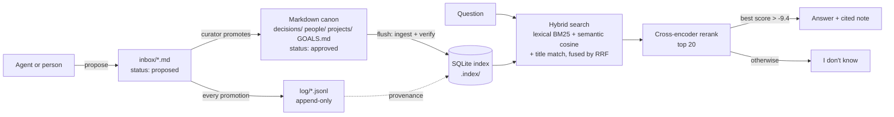

# BotCanon: how it works (internals)

Moved from README.md in v2. The README keeps the overview; this file keeps every detail.

A small, file-first second brain for people and AI agents. Your notes are plain Markdown in git. A SQLite index (FTS5 plus local embeddings) makes them searchable, and a test suite tells you when retrieval or freshness breaks.

In one sentence: agents *propose* facts, a curator *promotes* the good ones into plain Markdown files, and a small rebuildable SQLite index answers questions over those files with two kinds of search, a second-pass check, and an honest "I don't know".

## The problem, in engineering terms

- Agents forget everything between chats, or they misremember with confidence.
- Chat "memory" is unverified. Nobody checks it, and it goes stale without warning.
- Dumping notes into an embedding store returns whatever is closest, including outdated or low-authority facts. It never says "I don't know."
- Almost nobody tests retrieval, so it breaks silently.

What this kit does about each:

- **Forgetting:** notes live in plain Markdown in git, outside any one chat, so every agent reads the same record.
- **Unverified memory:** each fact carries who added it and where from (`why`), and agents can only `propose` to an inbox. A person promotes it.
- **Stale or low-authority hits:** search ranks decisions above notes and logs, and demotes superseded decisions. Freshness checks go RED when the index lags. `answer` says "I don't know" when the evidence is weak.
- **Untested retrieval:** `verify` runs golden questions on every change, and `bench.py` scores the retriever against plain embeddings.

It is for one person, or a small team, who runs several AI agents and wants them to share a memory they can audit.

## Storage, and why each piece

| Piece | What it holds | Why |
|---|---|---|
| **Markdown** (`decisions/`, `people/`, `projects/`, `GOALS.md`, `CURRENT.md`) | The source of truth. One fact or decision per note, with a `status:` line. | A person can read, edit, diff and review it in git with no tools. If every other piece is deleted, nothing is lost. |
| **SQLite** (`.index/brain.db`) | `notes(path, sha, title)`: sha256 of each file, so re-indexing touches only changed notes. `chunks(id, path, heading, text, emb)`: each note split by heading, with its embedding stored as a float32 BLOB. `fts`: an FTS5 full-text table over text, heading and title. `meta`: index time and schema version. | One file, no server, fast. It is **derived**: delete `.index/` and `ingest --full` rebuilds it exactly. A schema-version bump forces a full rebuild. |
| **JSONL** (`log/YYYY-MM.jsonl`) | An append-only log of every promoted claim. Fields: `id`, `ts`, `type`, `entity`, `text`, `from_agent`, `source`, `canon` (the note it landed in) and `successor` (the claim that replaced it). | History and provenance without rewriting notes. You can see who said what, when, and what overrode it. Lines are never edited. |

## Note status

Every canon note carries `status: proposed | approved | superseded` (frontmatter `status:` or a `- Status:` bullet).

- `inbox/` notes are `proposed`; `propose` writes this for you.
- Promoted notes are `approved`.
- A decision named on a newer decision's `Prior:` line is `superseded`.

Ranking reads the status first. If a note has none, it falls back to the folder and the `Prior:` lines. `verify` fails if a canon note is missing a status, has an invalid one, is still `proposed`, or if `superseded` notes and `Prior:` lines disagree. `tools/migrate_status.py` adds the field to an existing store; it is idempotent, and `--check` only reports.

## Two kinds of search, then a second pass

1. **Lexical (exact words).** SQLite FTS5 with BM25 ranking. Common words (a stopword list) are stripped. It first requires all remaining words (AND). If that finds nothing and the query has more than one word, it retries with any word (OR). A separate pass matches words against note **titles** only.
2. **Semantic (meaning).** Each chunk is embedded with `BAAI/bge-small-en-v1.5` (384-dimensional, runs on CPU). The query is embedded with the prefix `Represent this sentence for searching relevant passages: `, and chunks are ranked by cosine similarity. This finds "when do we close" in a note that says "closes Mondays".
3. **Fusion.** The lexical, semantic and title lists (40 candidates each) are merged by Reciprocal Rank Fusion: each list contributes `1 / (60 + rank)`. The sum is multiplied by the note's authority weight (below), and at most 2 chunks per note are kept.
4. **Rerank.** The top 20 are re-scored by a cross-encoder (`Xenova/ms-marco-MiniLM-L-6-v2`), which reads the question and passage together. The final order is an equal-weight RRF of the hybrid rank and the cross-encoder rank. `BRAIN_RERANK=0` turns this off.
5. **"I don't know".** `answer` cites a note only if the best cross-encoder score is above **-9.4**, and then only with a quoted line (cite-and-verify, below). With the reranker off, it needs a strict all-words lexical match or a cosine of at least **0.55**; a title-only or OR-only match is not enough.

## Hierarchy and weights (from `path_weight` in `tools/brain.py`)

| Note | Weight |
|---|---|
| `decisions/` (current) | 1.02 |
| `GOALS.md` | 1.02 |
| `people/`, `projects/` | 1.0 |
| `CURRENT.md` (derived dashboard) | 0.4 |
| `status: superseded` or `status: proposed` | 0.1 |
| superseded decision (named on a newer `Prior:` line, no status) | 0.1 |
| anything else (`log/`, `inbox/`) | 0.1 |

Decisions and goals edge out people and projects as a tie-breaker. The dashboard never outranks the notes it summarizes, and old or unreviewed material sinks without disappearing.

**OUTRANKED and SUPERSEDED.** `provenance` (`context` over MCP) returns the current decision first. Log claims dated before that decision are listed as OUTRANKED, and decisions replaced through `Prior:` are listed as SUPERSEDED. Old facts stay visible, but labeled, so an agent can't quote them as current.

## Freshness, flush, verify, CI

- **RED** (verify fails): a canon note is newer than the index, the store was never indexed, or an inbox item is older than 48 h.
- **YELLOW** (warning): a decision is past its `Revisit:` date.
- **`flush`** = ingest, then verify, then commit. Write canon only through it. **`verify`** runs every golden question in the store's tests (`evals/retrieval_tests.yaml`, built with `evals init` / `evals accept`; with none yet, verify says so and stays YELLOW) and requires recall@5 ≥ 0.9, freshness not RED, and the built-in checks to pass (status, supersession, freshness fixtures).
- **Tests file rules.** The top-level keys are `recall_at_5_floor` and `goldens:` (`cases:` is accepted as the older name). A tests file with 0 tests or any other top-level key makes verify RED and exit nonzero, so a typo can't turn into a silent pass. `expect_path` may be one note or a list of notes; with a list, the test passes when any of them is within `max_rank`. Answer-level tests use `expect_known: true|false` and run cite-and-verify, the path a bot actually gets; add `expect_cite: path:line` to require the quote to come from that exact line. The fixture has 5 such answers and 3 "I don't know" cases, so CI fails if `answer` quotes the wrong line.
- **CI** (`.github/workflows/ci.yml`, on every push to `main` and on pull requests): gitleaks over full history, hook install, ingest and verify on the test fixture, ingest and verify on the empty starter vault, `test_evals.py` (test builder), `test_cite.py` (answers quote the stating line or abstain), `test_incremental.py` (incremental re-index equals a full rebuild), the MCP end-to-end test, and `bench.py` followed by `git diff --exit-code README.md`, so the results table can't drift from the code.

## Cite-and-verify

`brain.py answer` returns an exact line from a cited note as `path:line "quote"`, and checks that the line is literally in the file. The line must state the question's specific attribute: at least 2/3 of its distinctive words (words in at most 25% of notes), exactly or through a close synonym (word-embedding cosine 0.75 or higher). Otherwise the answer is "I don't know". `answer --spans` also prints the top 3 verified candidate lines, so the answering agent can make the final call (rule 2 below). Code lives in `tools/cite.py`; set `BRAIN_OWNER="First Last"` so the owner's name never counts as an attribute.

## Retrieval results: notes on the public set

The test fixture (`tests/fixtures/vault/`, fictional, CI and bench only) is tiny (10 notes), so these numbers show how the pieces behave. They don't predict quality on a large vault. Run the script on your own vault with your own public set. The public set is never used for tuning, so its misses stay in the table: two flour questions rank the supplier decision above the supplier's note, "who does the books" misses, and "employee dental plan" returned notes until the reranker gate (below); with the gate on, all 3 no-answer questions now come back "I don't know", at the cost of one real question also getting "I don't know". Ten paraphrase questions (indirect wording, no names) were added on 2026-10-28. Before them, hybrid and lexical tied at Hit@1 0.83. With them, lexical falls to 0.68 while hybrid holds at 0.75, which is the case hybrid exists for.

## Design

- **Search:** hybrid. FTS5 with BM25 and porter stemming, cosine similarity on bge-small embeddings, and a title-match list, fused with reciprocal rank fusion. Stopwords are dropped, and a full-sentence question falls back to an OR query when the strict AND query finds nothing. At most 2 hits per note. Semantic hits below a similarity floor are dropped, so a question with no answer comes back empty.
- **Rerank:** the top 20 hybrid hits are re-scored by a local cross-encoder (`Xenova/ms-marco-MiniLM-L-6-v2`, via fastembed). The final order is an equal-weight RRF of the hybrid rank and the cross-encoder rank, so authority weights still count. `answer` says "I don't know" when the best cross-encoder logit is at or below -9.4. That cutoff was calibrated on a private 75-question vault plus off-topic questions, not on this public set. Set `BRAIN_RERANK=0` to turn it off and fall back to the lexical/cosine gate. Cost: ~0.5 s per query on 8 CPUs, plus a one-time ~80 MB model download.
- **Authority:** decisions and GOALS win ties (+2%) over people and projects. A decision named on a newer decision's `- Prior:` line sinks to 0.1. The weights break ties; they do not override relevance.
- **Compile:** for an entity, CURRENT is the newest non-superseded decision plus log claims dated after it. Older claims move to OUTRANKED, and claims with a `successor` move to SUPERSEDED.
- **Freshness:**
  - RED: a note is newer than the index, or an inbox item is older than 48 hours.
  - YELLOW: a decision is past its `Revisit: ~YYYY-MM-DD` date.
  - `Revisit: standing (no review date)` never comes due.
- **Verify:** runs every golden (expected path within a rank, rejected paths, no-answer cases) and enforces a recall@5 floor. It also runs the authority and freshness fixtures and checks that the git hooks are installed.
- **Provenance:** decisions carry `- From:` (who proposed) and `- Source:` (where it came from). Log claims carry `from_agent`, `ts`, `source`, and `canon` (the note they support). `why` shows all of these for the best match.
- **I don't know:** `answer` cites a note only when the best cross-encoder score is above -9.4 and a verified quoted line in that note states the asked attribute (cite-and-verify, above). With `BRAIN_RERANK=0` it falls back to a strict lexical match or a semantic match above the floor. Otherwise it returns "I don't know" with exit code 2, so scripts can branch on it.
- **Ingest:** incremental by sha256. A schema or embedding-model change triggers a full rebuild.

## Why it works this way

- **Files over a database.** Markdown in git is readable, diffable, and survives any tool. The index can always be deleted and rebuilt.
- **Chat memory is not a record.** Agents propose through `inbox/`, and one curator writes canon. "I remembered" is never a source.
- **Tests, not hope.** Each promotion adds a golden. Retrieval that quietly gets worse fails verify instead of misleading you later.
- **No clock.** flush runs on every write batch, so freshness doesn't depend on a scheduled job staying alive.
- **Small on purpose.** One file of Python, SQLite, and a local model. There is no server, graph database, or API key.

## CI

`.github/workflows/ci.yml` runs on every push to `main` and on pull requests: gitleaks over full history, hook install, ingest and verify on the test fixture, ingest and verify on the empty starter vault, `test_evals.py` (test builder), `test_cite.py` (answers quote the stating line or abstain), `test_incremental.py` (incremental re-index equals a full rebuild), the MCP end-to-end test, and `bench.py` followed by `git diff --exit-code README.md`, so the published results table cannot drift from the code. Releases are tagged; see `CHANGELOG.md`.

## Secret scanning

`tools/install-hooks.sh` installs a pre-commit hook (scans staged changes) and a pre-push hook (scans history), both with [gitleaks](https://github.com/gitleaks/gitleaks). They fail closed: if gitleaks is not on PATH, the commit or push is blocked with an install hint. Install gitleaks (`brew install gitleaks`, or put the release binary on PATH) and retry. Don't use `--no-verify`. `verify` fails if the hooks are not installed, so a fresh clone without them shows RED.
